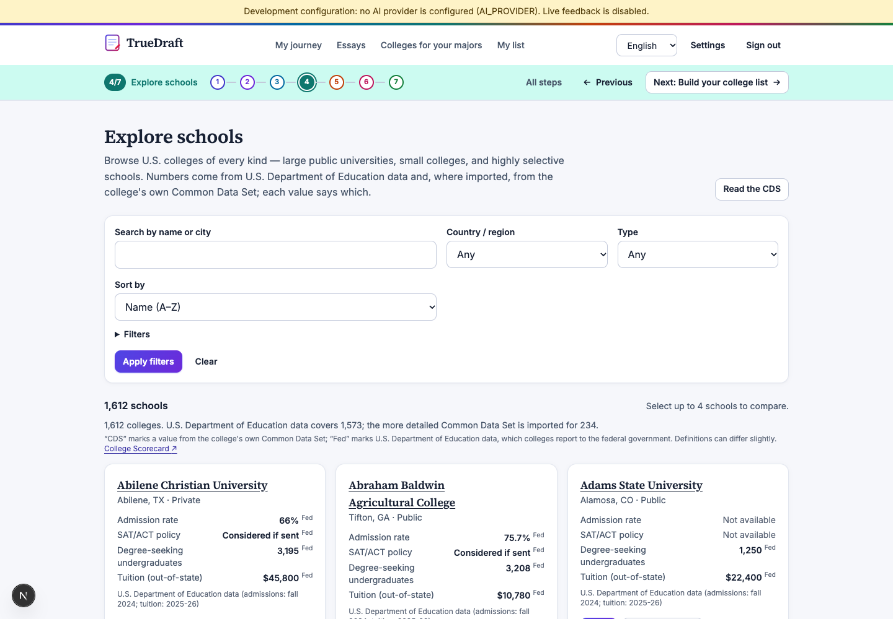
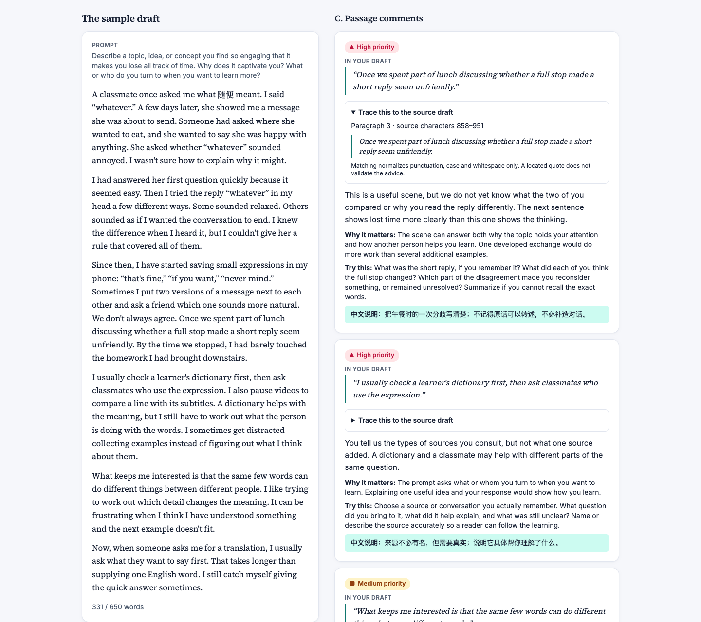
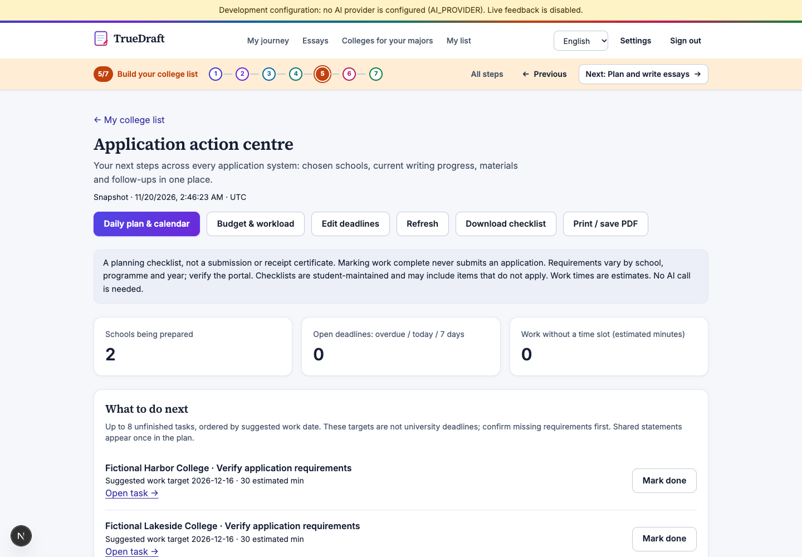

# TrueDraft

[Try the interactive demo](https://yangsy57272.github.io/TrueDraft/) · [Download](https://github.com/yangsy57272/TrueDraft/releases) · [简体中文](README.zh-CN.md) · [Contribute](CONTRIBUTING.md) · [Report a problem](https://github.com/yangsy57272/TrueDraft/issues)

**Your story. Your voice. Clearer feedback.**

你的故事，你的声音。更清晰、更透明的文书反馈。

TrueDraft is an open-source college application planner and AI essay coach that helps students explore colleges, organize applications, and revise their own essays. It brings college research, deadlines, budgets, and optional AI feedback into one workspace, with English and Simplified Chinese interfaces.

Whether you are choosing a major or polishing a final draft, TrueDraft helps you work through the next step while keeping your experiences and voice at the center.

## What you can do

- **Explore majors and colleges.** Build a profile of your interests and activities, compare schools, and understand the data behind suggested matches. Research covers the U.S., U.K., Hong Kong, Canada, Australia, and Singapore, with coverage varying by system.
- **Plan your applications.** Keep a college list, deadlines, document checklists, follow-ups, and application statuses together. Estimate costs and remaining work.
- **Develop your essays.** Use writing guides and supplemental prompts, save drafts automatically, compare versions, and export your writing.
- **Get optional AI coaching.** Unpack a prompt, brainstorm ideas, request passage feedback, and turn suggestions into a revision plan. Feedback is available in English, Chinese, or both.

TrueDraft is designed to support your writing and decisions. AI can make mistakes; review its suggestions and confirm current requirements with each college. School groupings are planning aids, and a “Safety” label guarantees neither admission nor affordability.

## Try it in your browser

**[Open the interactive demo](https://yangsy57272.github.io/TrueDraft/)** — no account or AI key needed. Explore a fictional college list, today’s work, a quoted essay comment, and a revision comparison. English and Chinese are available. Changes reset on reload.

[Watch the short walkthrough](https://yangsy57272.github.io/TrueDraft/demo-tour.webm) · [Quality methods and limits](docs/QUALITY.md) · [What’s new in 0.2.0](RELEASE_NOTES.md)

## Screenshots

Explore colleges with search, filters, and sourced data.



A worked example follows a student helping a classmate choose an English reply. The draft keeps everyday details and uncertainty; the feedback explains what to preserve, what needs development, and how to revise. Written for demonstration, rather than taken from a real application.



See application progress, checklists, and next steps together. The schools and application records below are fictional demonstration data.



<!-- sample-feedback:start -->
## A closer look at the feedback

The sample follows an ordinary student trying to help a classmate choose an English reply. The writer gets distracted discussing small phrases at lunch and is still working out what they think. The person, draft and feedback are illustrative and prepared for this walkthrough; this is not a real student’s submission or a live AI response.

<details>
<summary>Read the example: what to keep, what to develop, and how to revise</summary>

**What to keep:** Lunch and the neglected homework show the interest taking up time naturally. Keep this detail: it shows the interest competing with something else you meant to do.

**First priority: Let us follow one comparison, not just the habit.** Use the lunch conversation or the opening translation question to show your thinking at work. What did you initially think a reply meant? What detail made you or your friend read it differently? What did you conclude, or leave unresolved? A short exchange can connect the scene, your learning process and the reason you keep returning to the topic. Let that exchange carry the reflection. If you cannot remember the exact words, summarize the discussion accurately rather than creating a quotation.

> Once we spent part of lunch discussing whether a full stop made a short reply seem unfriendly.

**What needs work:** This is a useful scene, but we do not yet know what the two of you compared or why you read the reply differently. The next sentence shows lost time more clearly than this one shows the thinking.

**Why it matters:** The scene can answer both why the topic holds your attention and how another person helps you learn. One developed exchange would do more work than several additional examples.

**Try this:** What was the short reply, if you remember it? What did each of you think the full stop changed? Which part of the disagreement made you reconsider something, or remained unresolved? Summarize if you cannot recall the exact words.

> I usually check a learner's dictionary first, then ask classmates who use the expression.

**What needs work:** You tell us the types of sources you consult, but not what one source added. A dictionary and a classmate may help with different parts of the same question.

**Why it matters:** The prompt asks what or whom you turn to when you want to learn. Explaining one useful idea and your response would show how you learn.

**Try this:** Choose a source or conversation you actually remember. What question did you bring to it, what did it help explain, and what was still unclear? Name or describe the source accurately so a reader can follow the learning.

**A manageable revision order**

1. Choose the opening exchange or lunch discussion as the main example. Note what each person meant, the wording discussed and what you remember accurately. Done when you can separate remembered detail from a guess.
2. Expand that example with your initial reading, the other reading and what you reconsidered. Done when a reader can follow the comparison and understand why you wanted to keep thinking about it.
3. Connect one actual learning source or conversation to that example. Done when the reader can identify the question you asked, what you learned and what remained unclear. Keep other source types brief.
4. Clarify the English-message context, then trim examples that repeat the same point. Done when each remaining detail either helps us follow the exchange or adds something to your thinking.
5. Read the revised middle beside the opening and ending. Done when they describe a believable, still-developing habit, every prompt part is addressed, and all details are supportable. Check the 650-word ceiling last.

[Read the complete sample draft and feedback](docs/EXAMPLE_FEEDBACK.md), including all eight diagnostic areas, six passage comments, voice checks and questions for the writer.

</details>
<!-- sample-feedback:end -->

## Try the desktop app

Download the package for your system from **[GitHub Releases](https://github.com/yangsy57272/TrueDraft/releases)**:

- **Windows:** run the x64 installer.
- **macOS:** extract the Apple Silicon or Intel ZIP and open `TrueDraft.app`.
- **Linux:** extract the x64 or arm64 archive and run `./TrueDraft`.

The desktop app opens in your browser and stores your work on your device. Writing and planning work offline. To enable AI, open **Settings → AI connection settings** and configure a compatible provider or local service. Cloud AI may incur provider charges.

See the [desktop guide](docs/DESKTOP.md) for installation details, AI setup, and backups. Release downloads can lag behind features on the `main` branch.

## Your writing and data

You choose when to request AI help and are asked for consent before analysis. Relevant text is sent to the configured provider when you use AI; that provider’s data policies also apply. The editor works with AI turned off.

Drafts and other sensitive records are encrypted at rest. Some metadata, including essay titles and prompts, is stored unencrypted. TrueDraft includes data export and deletion controls and ships without third-party analytics. See [AI data flow](docs/AI_DATA_FLOW.md) for details.

College information includes source links and reporting periods where available. Coverage is incomplete, and requirements can change. Check official college websites and application portals before acting.

## Run locally

For developers, TrueDraft uses Next.js, TypeScript, SQLite, and Drizzle ORM.

1. Install Node.js **22.22.0** (see `.nvmrc`), then clone and install:

   ```bash
   git clone https://github.com/yangsy57272/TrueDraft.git
   cd TrueDraft
   npm ci
   cp .env.example .env
   ```

2. In `.env`, replace `BETTER_AUTH_SECRET` and `ENCRYPTION_KEYS`. Run `openssl rand -base64 32` twice: use one result for the secret and the other as `ENCRYPTION_KEYS=k1:<second-result>`. Keep `.env` private. Leave `AI_PROVIDER` empty to start without AI, or use `mock` for clearly labeled development feedback. Keep `EMAIL_TRANSPORT=console` for local sign-in.

3. Initialize the database and start:

   ```bash
   npm run db:migrate
   npm run db:seed
   npm run scorecard:import
   npm run cds:import
   npm run supplements:import
   npm run dev
   ```

4. Open [localhost:3000](http://localhost:3000), enter an email address, and use the sign-in link printed in your terminal.

Run `npm test` for unit and integration tests, or `npm run test:e2e` for browser tests. See [deployment](docs/DEPLOYMENT.md) and [AI evaluation](docs/AI_EVALUATION.md) for configuration and verification guidance.

## Learn more and contribute

- [College data and sources](docs/CDS_DATA.md)
- [Recommendations across application systems](docs/CROSS_SYSTEM_RECOMMENDATIONS.md)
- [Budget and time planning](docs/ADMISSION_BUDGET_PLAN.md)
- [Application action centre](docs/APPLICATION_ACTION_CENTRE.md)
- [Help test TrueDraft](docs/USER_TESTING.md)
- [Public preview architecture](docs/PUBLIC_PREVIEW.md)
- [Security and deployment review](docs/SECURITY_AND_LEGAL_REVIEW.md)

See the [contribution guide](CONTRIBUTING.md) for ways to help with testing, translations, accessibility, and college data.

If TrueDraft helps you, consider starring this repository or sharing it with a student who could use it.

Questions, bug reports, and improvement ideas are welcome through [GitHub Issues](https://github.com/yangsy57272/TrueDraft/issues). Please use fictional examples when reporting problems with essays or profiles.

TrueDraft is an independent project, unaffiliated with the Common App or any university.

## License

TrueDraft’s original code and documentation are licensed under the [MIT License](LICENSE), copyright © 2026 Shiyi Yang. Third-party dependencies and attributed external materials retain their own licenses and terms.
