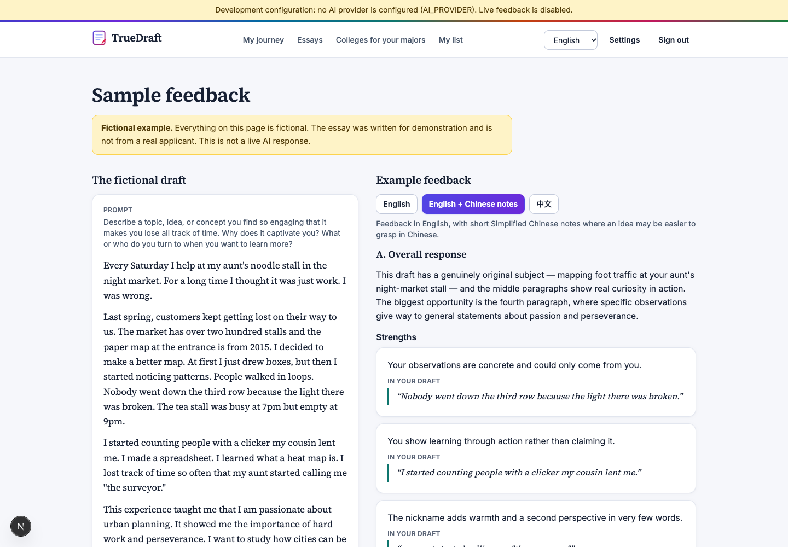

# TrueDraft

[Download](https://github.com/yangsy57272/TrueDraft/releases) · [简体中文](README.zh-CN.md) · [Contribute](CONTRIBUTING.md) · [Report a problem](https://github.com/yangsy57272/TrueDraft/issues)

**Your story. Your voice. Clearer feedback.**

你的故事，你的声音。更清晰、更透明的文书反馈。

TrueDraft is an open-source college application planner and AI essay coach that helps students explore colleges, organize applications, and revise their own essays. It brings college research, deadlines, budgets, and optional AI feedback into one workspace, with English and Simplified Chinese interfaces.

Whether you are choosing a major or polishing a final draft, TrueDraft helps you work through the next step while keeping your experiences and voice at the center.

## What you can do

- **Explore majors and colleges.** Build a profile of your interests and activities, compare schools, and understand the data behind suggested matches. Research covers the U.S., U.K., Hong Kong, Canada, Australia, and Singapore, with coverage varying by system.
- **Plan your applications.** Keep a college list, deadlines, document checklists, follow-ups, and application statuses together. Estimate costs and remaining work.
- **Develop your essays.** Use writing guides and supplemental prompts, save drafts automatically, compare versions, and export your writing.
- **Get optional AI coaching.** Unpack a prompt, brainstorm ideas, request passage feedback, and turn suggestions into a revision plan. Feedback is available in English, Chinese, or both.

TrueDraft is designed to support your writing and decisions. AI can make mistakes; review its suggestions and confirm current requirements with each college. School groupings are planning aids, and a “Safety” label guarantees neither admission nor affordability.

## Screenshots

Explore colleges with search, filters, and sourced data.


Read structured feedback alongside a draft, with English and Chinese options. This built-in example is fictional and hand-written, rather than a live AI response.



See application progress, checklists, and next steps together. The schools and application records below are fictional demonstration data.


## Try the desktop app

Download the package for your system from **[GitHub Releases](https://github.com/yangsy57272/TrueDraft/releases)**:

- **Windows:** run the x64 installer.
- **macOS:** extract the Apple Silicon or Intel ZIP and open `TrueDraft.app`.
- **Linux:** extract the x64 or arm64 archive and run `./TrueDraft`.

The desktop app opens in your browser and stores your work on your device. Writing and planning work offline. To enable AI, open **Settings → AI connection settings** and configure a compatible provider or local service. Cloud AI may incur provider charges.

See the [desktop guide](docs/DESKTOP.md) for installation details, AI setup, and backups. Release downloads can lag behind features on the `main` branch.

## Your writing and data

You choose when to request AI help and are asked for consent before analysis. Relevant text is sent to the configured provider when you use AI; that provider’s data policies also apply. The editor works with AI turned off.

Drafts and other sensitive records are encrypted at rest. Some metadata, including essay titles and prompts, is stored unencrypted. TrueDraft includes data export and deletion controls and ships without third-party analytics. See [AI data flow](docs/AI_DATA_FLOW.md) for details.

College information includes source links and reporting periods where available. Coverage is incomplete, and requirements can change. Check official college websites and application portals before acting.

## Run locally

For developers, TrueDraft uses Next.js, TypeScript, SQLite, and Drizzle ORM.

1. Install Node.js **22.22.0** (see `.nvmrc`), then clone and install:

   ```bash
   git clone https://github.com/yangsy57272/TrueDraft.git
   cd TrueDraft
   npm ci
   cp .env.example .env
   ```

2. In `.env`, replace `BETTER_AUTH_SECRET` and `ENCRYPTION_KEYS`. Run `openssl rand -base64 32` twice: use one result for the secret and the other as `ENCRYPTION_KEYS=k1:<second-result>`. Keep `.env` private. Leave `AI_PROVIDER` empty to start without AI, or use `mock` for clearly labeled development feedback. Keep `EMAIL_TRANSPORT=console` for local sign-in.

3. Initialize the database and start:

   ```bash
   npm run db:migrate
   npm run db:seed
   npm run scorecard:import
   npm run cds:import
   npm run supplements:import
   npm run dev
   ```

4. Open [localhost:3000](http://localhost:3000), enter an email address, and use the sign-in link printed in your terminal.

Run `npm test` for unit and integration tests, or `npm run test:e2e` for browser tests. See [deployment](docs/DEPLOYMENT.md) and [AI evaluation](docs/AI_EVALUATION.md) for configuration and verification guidance.

## Learn more and contribute

- [College data and sources](docs/CDS_DATA.md)
- [Recommendations across application systems](docs/CROSS_SYSTEM_RECOMMENDATIONS.md)
- [Budget and time planning](docs/ADMISSION_BUDGET_PLAN.md)
- [Application action centre](docs/APPLICATION_ACTION_CENTRE.md)
- [Security and deployment review](docs/SECURITY_AND_LEGAL_REVIEW.md)

See the [contribution guide](CONTRIBUTING.md) for ways to help with testing, translations, accessibility, and college data.

If TrueDraft helps you, consider starring this repository or sharing it with a student who could use it.

Questions, bug reports, and improvement ideas are welcome through [GitHub Issues](https://github.com/yangsy57272/TrueDraft/issues). Please use fictional examples when reporting problems with essays or profiles.

TrueDraft is an independent project, unaffiliated with the Common App or any university.

## License

TrueDraft’s original code and documentation are licensed under the [MIT License](LICENSE), copyright © 2026 Shiyi Yang. Third-party dependencies and attributed external materials retain their own licenses and terms.
